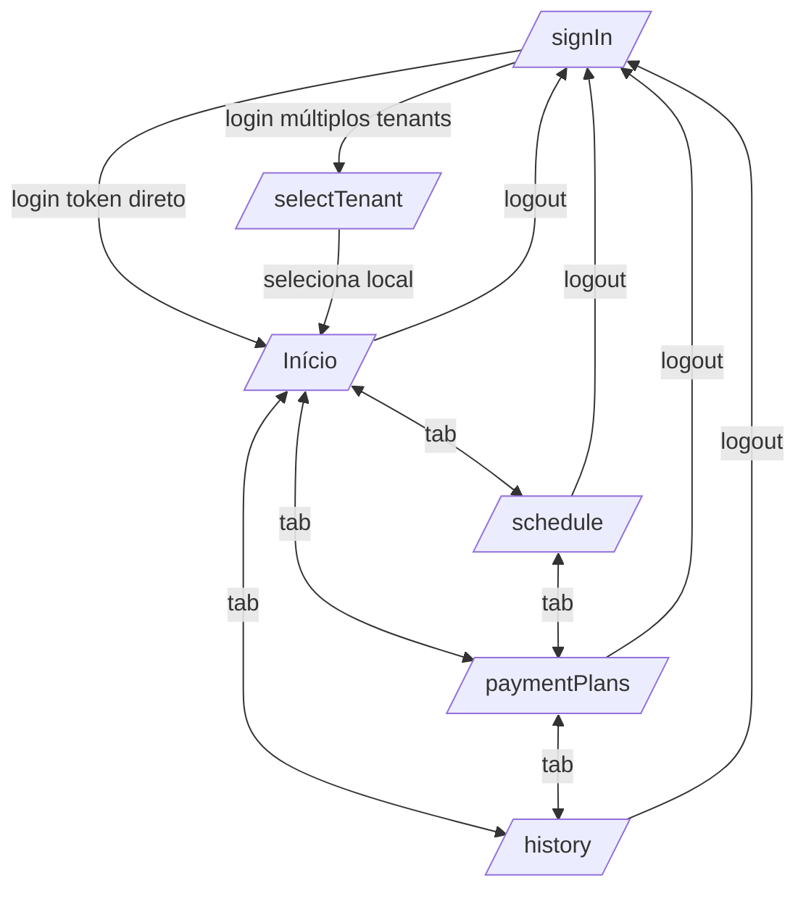

# Especificação Funcional — Krava (Figma / UX / Prototipação)

> Documento gerado a partir da análise do código-fonte (`src/`). App **React Native / Expo** (iOS, Android, Web). Cor primária **`#e95a07`** (`mainOrange`). Itens não confirmados no código estão marcados como **Necessita validação**.

## Paleta e tokens (de `components/ClientHeader.tsx`)

| Token | Valor | Uso |
|---|---|---|
| `mainOrange` | `#e95a07` | Cor primária (botões, seleção, destaques) |
| `subOrange` | `#fbdecd` | Fundos suaves, avatar |
| `foreground` | `#111827` | Texto principal |
| `mutedForeground` / `grayLabels` | `#6b7280` | Texto secundário / labels |
| `border` | `#e5e7eb` | Bordas |
| `destructive` | `#ef4444` | Erros, faltas, logout |
| Navy | `#0f172a` | Cards de destaque (próxima aula, plano atual) |
| Verde | `#16a34a` / `#22c55e` | Sucesso, presenças, confirmado |

**Navegação global**: Tab bar inferior com 4 abas — **Início** (Home), **Agendamento** (Calendar), **Planos** (CreditCard), **Histórico** (Clock).

---

# Tela 1 — Login

- **Nome da Tela**: Login (`/signIn`)
- **Objetivo**: Autenticar o usuário por e-mail e senha.
- **Layout**: Tela centralizada verticalmente, fundo branco, card único com largura máxima 400px. Logo e título no topo, formulário no centro, link "Criar conta" no rodapé.

### Componentes
- `KravaLogo` (64px) + título "krava" + subtítulo "Gestão esportiva inteligente".
- Formulário com dois grupos de input.
- Mensagem de erro (condicional).
- Botão primário "Entrar" e link "Criar conta".

### Campos
| Campo | Tipo | Obrigatório | Validação | Máscara |
|---|---|---|---|---|
| E-mail | texto (email keyboard, no autocapitalize) | Sim | Formato e-mail (schema Zod; **não aplicado na UI — Necessita validação**) | — |
| Senha | password (`secureTextEntry`) | Sim | Apenas string | Pontos ocultos |

### Botões
- **Entrar** (primário) — habilitado sempre; desabilita e mostra spinner durante loading.
- **Criar conta** (link) — **sem ação implementada** (**Necessita validação**).

### Regras
- Se e-mail ou senha vazios, o clique em Entrar não faz nada.
- Erro exibido abaixo dos campos.

### Estados
- **Loading**: botão com opacidade 0.7, `ActivityIndicator` no lugar do texto.
- **Sucesso**: redireciona (ver Fluxos).
- **Erro**: texto vermelho centralizado (`error`).
- **Sem dados**: n/a.

### Fluxos
**Ao clicar em [Entrar]:**
1. Valida presença de e-mail e senha (retorna se vazios).
2. Chama `POST /auth/login`.
3. Exibe loading (spinner no botão).
4. **Sucesso** → sem mensagem; redireciona:
   - Se resposta tem `preAuthToken` + `availableTenants` → **Tela 2 (Seleção de local)**.
   - Senão → **Tela 3 (Início)**.
5. **Erro** → exibe `error.data.detail || message`.

**Ao clicar em [Criar conta]:** nenhuma ação (**Necessita validação**).

### Wireframe textual
```
┌──────────────────────────────────────┐
│                                      │
│                [ K ]                 │
│                krava                 │
│      Gestão esportiva inteligente     │
│                                      │
│   E-mail                             │
│   ┌────────────────────────────────┐ │
│   │ seu@email.com                  │ │
│   └────────────────────────────────┘ │
│   Senha                              │
│   ┌────────────────────────────────┐ │
│   │ ••••••••                       │ │
│   └────────────────────────────────┘ │
│   [ ! mensagem de erro (cond.) ]     │
│   ┌────────────────────────────────┐ │
│   │            ENTRAR              │ │  ← laranja
│   └────────────────────────────────┘ │
│                                      │
│             Criar conta              │  ← link laranja
└──────────────────────────────────────┘
```

---

# Tela 2 — Seleção de local (Tenant)

- **Nome da Tela**: Seleção de local (`/selectTenant`)
- **Objetivo**: Escolher em qual local/tenant o usuário deseja entrar (quando há múltiplos).
- **Layout**: Fundo escuro (`#18181b`). Header centralizado com logo "K", título e subtítulo. Lista vertical de cards brancos.

### Componentes
- Header (logo, "Selecione o local", subtítulo).
- `FlatList` de cards de tenant (ícone por papel + nome + papel).

### Campos
- Nenhum (seleção por toque).

### Botões
- **Card de tenant** — seleciona o local.

### Regras
- Ícone/rótulo por papel: `Admin` → grid/"Administrador"; `Aluno` → capelo/"Aluno"; outros → users/"Professor".
- Redireciona a `/signIn` se não houver estado de seleção.

### Estados
- **Loading**: cards com opacidade 0.7 e desabilitados durante a seleção.
- **Sucesso**: autentica e redireciona.
- **Erro**: exposto por `error` do hook (**sem UI dedicada de erro na tela — Necessita validação**).
- **Sem dados**: lista vazia se `availableTenants` vazio (**sem empty state dedicado — Necessita validação**).

### Fluxos
**Ao clicar em [Card de tenant]:**
1. (Sem validação de formulário.)
2. Chama `POST /auth/select-tenant` com `{ preAuthToken, tenantId }`.
3. Exibe loading (opacidade nos cards).
4. **Sucesso** → autentica → redireciona para **Tela 3 (Início)**.
5. **Erro** → estado `error` do hook.

### Wireframe textual
```
┌──────────────────────────────────────┐  (fundo escuro)
│                [ K ]                 │
│           Selecione o local           │
│   Escolha qual local deseja acessar   │
│                                      │
│   ┌────────────────────────────────┐ │
│   │ [icon]  Nome do Local          │ │
│   │         Aluno                  │ │
│   └────────────────────────────────┘ │
│   ┌────────────────────────────────┐ │
│   │ [icon]  Outro Local            │ │
│   │         Administrador          │ │
│   └────────────────────────────────┘ │
│                ...                   │
└──────────────────────────────────────┘
```

---

# Tela 3 — Início (Home)

- **Nome da Tela**: Início (`/`)
- **Objetivo**: Painel do aluno — perfil, próxima aula, aulas da semana e aulas disponíveis para agendamento imediato.
- **Layout**: Header fixo (`ClientHeader`). Bloco de perfil, card navy "Próxima aula", calendário semanal, seções de título e `FlatList` de aulas disponíveis. Modal de confirmação sobreposto.

### Componentes
- `ClientHeader` (logo + avatar/dropdown).
- `UserProfile` (avatar, saudação, badge de nível, local).
- `NextClassCard` (card navy).
- `WeekCalendar` (7 dias + card de detalhe).
- `FlatList` de `AvailableClassItem`.
- `ConfirmBookingModal`.

### Campos
- Nenhum.

### Botões
- **Cancelar** (próxima aula) — **sem ação** (**Necessita validação**).
- **Dia da semana** — seleciona/deseleciona dia com aula.
- **Agendar** (por aula) — abre modal.
- **Confirmar/Cancelar/X** (modal).
- **Avatar → Sair** (dropdown).

### Regras
- Badge de nível por `user.studentLevel` (Iniciante/Intermediário/Avançado).
- Aulas disponíveis: janela hoje → hoje+15, `openForEnrollment: true`.
- Elegibilidade por gênero e nível controla exibição do botão Agendar (ver "Regras de elegibilidade" ao final).

### Estados
- **Loading**: `NextClassCard` e `WeekCalendar` mostram **skeletons**; lista mostra `ActivityIndicator`.
- **Sucesso**: dados renderizados.
- **Erro**: `NextClassCard` mostra card de erro ("Erro ao carregar a próxima aula").
- **Sem dados**: `NextClassCard` retorna `null` se não há `aulaId`; lista mostra "Nenhuma aula disponível no momento".

### Fluxos
**Ao clicar em [Agendar] → [Confirmar] (modal):**
1. (Sem validação de formulário; regra de elegibilidade já filtra a exibição do botão.)
2. Abre `ConfirmBookingModal` (texto = "agendar" ou "entrar na fila de espera" se lotada).
3. Ao Confirmar: chama `POST /scheduling/bookings` (`{ ocorrenciaId, source:'str', isTrial:false }`).
4. Exibe loading (spinner no botão Confirmar; botões desabilitados).
5. **Sucesso** → invalida query `["schedule"]`, fecha modal, limpa seleção (**sem toast de sucesso — Necessita validação**).
6. **Erro** → logado no console (**sem UI de erro no modal — Necessita validação**).

**Ao clicar em [Sair] (dropdown):** limpa AsyncStorage → redireciona para **Tela 1 (Login)**.

### Wireframe textual
```
┌──────────────────────────────────────┐
│ [logo krava]                    (AV) │  ← ClientHeader
├──────────────────────────────────────┤
│ (av) Olá, Fulano  [Iniciante]        │
│      Nome do Local                   │
│ ┌──────────────────────────────────┐ │
│ │ PRÓXIMA AULA                     │ │  ← card navy
│ │ [🏋] Aula — hoje 19:00           │ │
│ │      Prof. Beltrano              │ │
│ │ Confirmado ✓   ⏱ Faltam 2h30min  │ │
│ │                     [ Cancelar ] │ │
│ └──────────────────────────────────┘ │
│ AULAS DA SEMANA                      │
│ Seg Ter Qua Qui Sex Sáb Dom          │
│ (○) (○) (●) (○) (●) (○) (○)          │
│ AULAS DISPONÍVEIS AGORA              │
│ Abertas para agendamento             │
│ ┌──────────────────────────────────┐ │
│ │ 19:00  Prof.X    3/12  [Agendar] │ │
│ │ Muay Thai        [status/badge]  │ │
│ └──────────────────────────────────┘ │
│                ...                   │
├──────────────────────────────────────┤
│ [Início] [Agenda] [Planos] [Histór.] │  ← tab bar
└──────────────────────────────────────┘
```

---

# Tela 4 — Agendamento

- **Nome da Tela**: Agendamento (`/schedule`)
- **Objetivo**: Filtrar e agendar aulas por modalidade e dia (próximos 10 dias).
- **Layout**: Header fixo + faixa de filtros (categorias em pills + dias em cards horizontais) + `FlatList` de cards de aula. Modal de confirmação sobreposto.

### Componentes
- `ClientHeader`.
- `CategoryFilter` (pills horizontais).
- `DayCalendar` (10 cards de dia).
- `FlatList` de `ClassCard` (horário, tags nível/gênero, professor, barra de vagas, ação).
- `ConfirmBookingModal`.

### Campos
- **Categoria** (seleção via pill) e **Dia** (seleção via card). Sem inputs de texto.

### Botões
- **Pill de categoria** / **Card de dia** — atualizam filtros.
- **Agendar** — abre modal (se elegível e liberada).
- Modal: **Confirmar/Cancelar/X**.

### Regras
- Primeira categoria selecionada automaticamente ao carregar (`useEffect`).
- Barra de progresso = `confirmedCount/maxCapacity`.
- "Libera em ..." quando `releaseAt` é futuro.
- Elegibilidade de gênero/nível desabilita/oculta o botão.

### Estados
- **Loading**: skeletons nas pills; `ActivityIndicator` central na lista.
- **Sucesso**: cards renderizados.
- **Erro**: pills → "Erro ao carregar categorias"; lista → "Erro ao carregar agenda" + detalhe.
- **Sem dados**: "Nenhuma aula encontrada para este dia".

### Fluxos
**Ao selecionar [Categoria] ou [Dia]:**
1. Atualiza estado (`selectedCategory`/`selectedDay`).
2. Redispara `GET /scheduling/ocorrencias` (queryKey muda).
3. Loading → lista atualizada.

**Ao clicar em [Agendar] → [Confirmar]:** idêntico ao fluxo da Tela 3 (mesmo modal/handlers).

### Wireframe textual
```
┌──────────────────────────────────────┐
│ [logo krava]                    (AV) │
├──────────────────────────────────────┤
│ (Todas)(Muay)(Boxe)(Jiu) ...  ←pills │
│ ┌──┐┌──┐┌──┐┌──┐┌──┐  ← dias (10)    │
│ │Seg││Ter││Qua││Qui││Sex│            │
│ │ 14││ 15││ 16││ 17││ 18│            │
│ └──┘└──┘└──┘└──┘└──┘                 │
├──────────────────────────────────────┤
│ ┌──────────────────────────────────┐ │
│ │ 19:00  Muay Thai                 │ │
│ │ 20:00  [Iniciante][⚥ Mista] Prof.│ │
│ │ ▓▓▓▓▓░░░░  8/12                   │ │
│ │                        [Agendar] │ │
│ └──────────────────────────────────┘ │
│                ...                   │
├──────────────────────────────────────┤
│ [Início] [Agenda] [Planos] [Histór.] │
└──────────────────────────────────────┘
```

---

# Tela 5 — Planos

- **Nome da Tela**: Planos (`/paymentPlans`)
- **Objetivo**: Exibir plano atual, listar planos disponíveis e permitir solicitar vinculação com parceiros (Gympass/Totalpass).
- **Layout**: Header fixo + `ScrollView`: card navy "Plano atual", lista de cards de plano, card de parceiros. Modal de vinculação sobreposto.

### Componentes
- `ClientHeader`.
- `CurrentPlanCard` / `CurrentPlanSkeleton` (card navy).
- Lista de `PlanCard`.
- Card "Utilizo Gympass ou Totalpass".
- `Modal` de vinculação (dropdown + input + aviso).

### Campos (modal)
| Campo | Tipo | Obrigatório | Validação | Máscara |
|---|---|---|---|---|
| Parceiro | dropdown (Gympass/Totalpass) | Não (sem validação) | — | — |
| ID no parceiro | texto | Não (opcional) | — | — |

### Botões
- **Tentar novamente** (erro do plano atual) — `refetchCurrent()`.
- **Assinar Plano** — **sem ação** (**Necessita validação**).
- **Solicitar vinculação** — abre modal.
- **Enviar solicitação** — fecha e limpa (sem API — **Necessita validação**).

### Regras
- Progresso de aulas só se `maxClassesPerMonth > 0`; senão "Aulas ilimitadas".
- Status "Ativo" → badge confirmado; senão "encerrada".
- Badge "Mais popular" quando nome contém "trimestral".

### Estados
- **Loading**: `CurrentPlanSkeleton` para plano atual; `ActivityIndicator` para lista de planos.
- **Sucesso**: cards renderizados.
- **Erro**: plano atual → card com "Tentar novamente"; lista → "Erro ao carregar planos" + detalhe.
- **Sem dados**: plano atual → "Você ainda não possui um plano ativo".

### Fluxos
**Ao clicar em [Solicitar vinculação]:**
1. Abre modal.
2. Usuário escolhe parceiro e opcionalmente ID.
3. Ao clicar **Enviar solicitação** → `handleSendRequest` fecha e limpa (**sem API — Necessita validação**).

**Ao clicar em [Tentar novamente]:** `GET /plans/current` (refetch) → skeleton → resultado.

**Ao clicar em [Assinar Plano]:** nenhuma ação (**Necessita validação**).

### Wireframe textual
```
┌──────────────────────────────────────┐
│ [logo krava]                    (AV) │
├──────────────────────────────────────┤
│ ┌──────────────────────────────────┐ │  ← card navy
│ │ SEU PLANO ATUAL       [Ativo ✓]  │ │
│ │ Plano Mensal                     │ │
│ │ [Muay Thai][Boxe]                │ │
│ │ 8 de 12 aulas usadas       67%   │ │
│ │ ▓▓▓▓▓▓▓░░░                        │ │
│ │ Início 01/07  Término 31/07      │ │
│ │ Restantes 4   Renov. Ativada     │ │
│ └──────────────────────────────────┘ │
│ ┌──────────────────────────────────┐ │
│ │ Plano Trimestral   [★ Popular]   │ │
│ │ R$150,00/mês   3x semana•90 dias │ │
│ │ ✓ ... ✓ ... ✓ ...                │ │
│ │ [        Assinar Plano         ] │ │
│ └──────────────────────────────────┘ │
│ ┌──────────────────────────────────┐ │
│ │ 💳 Utilizo Gympass ou Totalpass  │ │
│ │ [   Solicitar vinculação      ]  │ │
│ └──────────────────────────────────┘ │
├──────────────────────────────────────┤
│ [Início] [Agenda] [Planos] [Histór.] │
└──────────────────────────────────────┘
```

**Modal de vinculação:**
```
        ┌────────────────────────────┐
        │ Solicitar vinculação       │
        │ ┌────────────────────────┐ │
        │ │ Selecione o parceiro ▾ │ │
        │ └────────────────────────┘ │
        │ ┌────────────────────────┐ │
        │ │ Seu ID (opcional)      │ │
        │ └────────────────────────┘ │
        │ ⚠ Análise em até 24h       │
        │ [   Enviar solicitação   ] │
        └────────────────────────────┘
```

---

# Tela 6 — Histórico

- **Nome da Tela**: Histórico (`/history`)
- **Objetivo**: Exibir resumo mensal (presenças/faltas/restantes) e histórico de agendamentos, com filtro por modalidade.
- **Layout**: Header fixo + `ScrollView`: resumo "Mês Atual", faixa de filtros (pills), lista de cards de histórico.

### Componentes
- `ClientHeader`.
- `HistorySummary` (3 caixas + barra de progresso).
- `CategoryFilter` (pills: "Todas" + categorias).
- Lista de `HistoryCard`.

### Campos
- Filtro por modalidade (seleção via pill). Sem inputs.

### Botões
- **Pill de filtro** — filtra histórico.

### Regras
- `isUnlimited` quando `availableForSchedulingThisMonth === null` → ícone ∞.
- Status: Confirmado / Presente ✓ (CheckedIn) / Falta ⚠ (Faltou) / Desconhecido.
- Card com borda esquerda vermelha se "Faltou".

### Estados
- **Loading**: 5 skeleton cards; `ActivityIndicator` no resumo.
- **Sucesso**: cards renderizados.
- **Erro**: exposto por `error` do hook (**sem UI de erro dedicada na lista — Necessita validação**).
- **Sem dados**: "Nenhum histórico encontrado".

### Fluxos
**Ao selecionar [Pill de filtro]:**
1. Atualiza `filtroId`/`filtroName`.
2. Redispara `GET /scheduling/my-history` (`modalityId`). Também re-executa `GET /checkin/my-status` (**sem `modalityId` — Necessita validação**).
3. Loading (skeletons) → lista filtrada (filtro adicional local por `modalityName`).

### Wireframe textual
```
┌──────────────────────────────────────┐
│ [logo krava]                    (AV) │
├──────────────────────────────────────┤
│ Mês Atual                            │
│ ┌────────┐┌────────┐┌────────┐       │
│ │  12    ││   2    ││   4    │       │
│ │Presenç.││ Faltas ││Restant.│       │
│ └────────┘└────────┘└────────┘       │
│ 12/16 check-ins do plano      75%    │
│ ▓▓▓▓▓▓▓▓░░                            │
│ (Todas)(Muay)(Boxe) ...  ← pills     │
├──────────────────────────────────────┤
│ ┌──────────────────────────────────┐ │
│ │ Ter │ Muay Thai 19:00  [Presente]│ │
│ │ 15/07│ Prof. X                   │ │
│ └──────────────────────────────────┘ │
│ ┌──────────────────────────────────┐ │
│ ▌│ Qui │ Boxe 20:00   [Falta ⚠]    │ │  ← borda vermelha
│ │ 17/07│ Prof. Y                   │ │
│ └──────────────────────────────────┘ │
├──────────────────────────────────────┤
│ [Início] [Agenda] [Planos] [Histór.] │
└──────────────────────────────────────┘
```

---

# Componente global — ClientHeader + Dropdown de perfil

- **Objetivo**: Cabeçalho com logo e acesso ao perfil/logout.
- **Componentes**: `KravaLogo`, avatar (iniciais), `ProfileDropdown` (modal).
- **Botões**: Avatar (abre dropdown); **Sair** (logout).
- **Regras**: dropdown exibe `userName`, `tenantName`, "Plano Intermediário" (**hardcoded — Necessita validação**).

### Fluxo
**Ao clicar em [Sair]:** fecha dropdown → `signOut()` → limpa AsyncStorage → redireciona para **Tela 1 (Login)**.

### Wireframe textual
```
┌──────────────────────────────────────┐
│ [logo krava]                    (AV) │
└──────────────────────────────────────┘
                        ┌──────────────┐
                        │ Fulano       │
                        │ Nome do Local│
                        │ Plano Interm.│
                        │ ──────────── │
                        │ ⎋ Sair       │
                        └──────────────┘
```

---

# Componente global — ConfirmBookingModal

- **Objetivo**: Confirmar agendamento (ou entrada em fila de espera).
- **Abrir**: botão "Agendar" (Início/Agendamento).
- **Fechar**: Cancelar, X, toque no overlay, `onRequestClose`, ou sucesso.
- **Regras**: texto muda para "entrar na fila de espera" se `confirmedCount >= maxCapacity`; botões desabilitados e spinner durante `isCreatingSchedule`.

### Wireframe textual
```
        ┌────────────────────────────┐
        │ Confirmar Agendamento    X │
        │ Deseja realmente agendar a │
        │ aula de Muay Thai às 19:00?│
        │        [Cancelar][Confirmar]│
        └────────────────────────────┘
```

---

# Regras de elegibilidade de agendamento (globais)

Aplicadas na **camada de apresentação** (Início e Agendamento). Autoridade final = backend. **Necessita validação**.

- **Gênero**: permitido se `Mixed` ou `= user.gender`; senão "Apenas <gênero>".
- **Nível**: iniciante(1) < intermediario(2) < avancado(3); permitido se `user.studentLevel ≥ minLevel`; senão "Requer nível X".
- **Liberação**: `releaseAt` futuro → "Libera em ...".
- **Capacidade**: lotada → fluxo de fila de espera.
- **Inscrição existente**: `subscriptionStatus` mostra status em vez do botão.

---

# Diagrama de navegação (Mermaid)



---

# Matriz de estados por tela (referência para protótipo)

| Tela | Loading | Sucesso | Erro | Sem dados |
|---|---|---|---|---|
| Login | Spinner no botão | Redireciona | Texto de erro | n/a |
| Seleção de local | Opacidade nos cards | Redireciona | (sem UI — validar) | (sem empty — validar) |
| Início | Skeletons + spinner | Conteúdo | Card de erro (próxima aula) | Card oculto / "Nenhuma aula disponível" |
| Agendamento | Skeletons + spinner | Cards | "Erro ao carregar agenda" | "Nenhuma aula encontrada" |
| Planos | Skeleton + spinner | Cards | Card "Tentar novamente" / erro lista | "Sem plano ativo" |
| Histórico | 5 skeletons + spinner | Cards | (sem UI — validar) | "Nenhum histórico encontrado" |

---

## Observações para UX/design (**Necessita validação**)

- **Ações incompletas** que precisam de definição de fluxo/telas: "Criar conta", "Cancelar" próxima aula, "Assinar Plano", "Enviar solicitação" (parceiros).
- **Feedback de sucesso ausente**: agendamento não exibe toast/confirmação visual após sucesso — recomendável para UX.
- **Erros silenciosos**: erro de agendamento e alguns erros de lista só aparecem no console — precisam de tratamento visual.
- **Modal de parceiros** sem botão de cancelar/fechar explícito.
- **Textos hardcoded**: "Plano Intermediário" (dropdown), "FitPira Arena" (modal de parceiros).
- **Sem tema escuro consistente**: apenas a Seleção de local usa fundo escuro; demais telas são claras.
